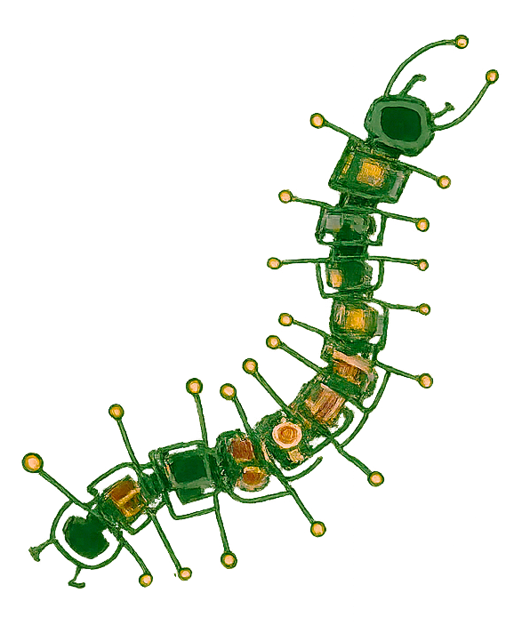
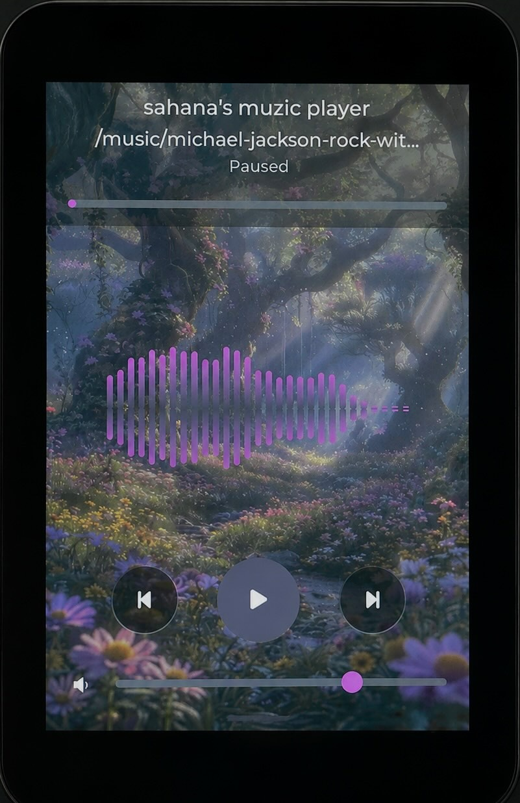
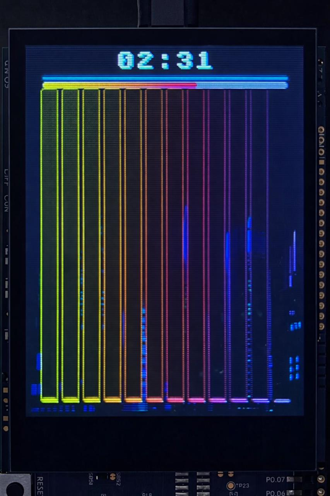
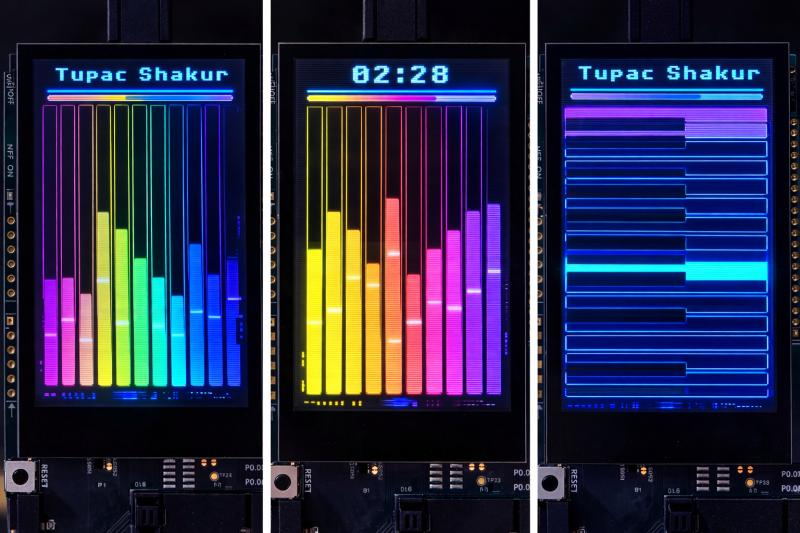

  

  

  

    <strong><em>whimsymaxxing at my desk .... ༻*ੈ✩‧₊˚</em></strong>
    
      
    ELECTRICAL ENGINEERING @ UCALGARY
     
    embedded systems • control systems • low-level IC.
     
    ૮₍ ´ ꒳ `₎ა
  

  
 

## 🧵 things i've built

<em>(the short, honest version — click a title for the actual code)</em>

### [Schulich on Chip — RISC-V SoC Verification](https://github.com/Schulich-on-a-Chip/core-v-mcu)
  

- hardened peripheral RTL (UART, I²C, I²S, uDMA) on an open-source CORE-V-MCU SoC
- verified it with cocotb testbenches, then pushed modules through the LibreLane RTL-to-GDS flow
- currently running a variety of tests on the numerous protocols of the RTL on the beloved basys3! 

### [muzic-player — Embedded Audio Player & Visualizer](https://github.com/SahanaSant/muzic-player)
  

  

- touchscreen WAV player with a radix-2 Cooley–Tukey FFT I wrote from scratch, driving a live 13-band spectrum visualizer
- windowing + DC removal clean up 1024-sample snapshots of the raw PCM stream before each transform
- FFT bins grouped into log-spaced bands (20 Hz–16 kHz), peak power per band → bar height
- runs on its own low-priority FreeRTOS task so it never once stutters the audio it's dancing to

### [Nrf52840-Midi-Visualizer](https://github.com/SahanaSant/Nrf52840-Midi-Visualizer)
  

  
  &nbsp;&nbsp;
  

- MIDI file parser I wrote byte-by-byte, no external library — raw header/track chunks, variable-length delta-times, running status, tempo and note events
- feeds a 12-band EQ and piano-mode visualizer on an nRF52840
- notes sorted bass-to-treble with a velocity-weighted histogram, not a flat 12-way split

**how piano mode maps notes → keys:**
- each frame scans the 12 EQ bars for the 3 strongest
- 2 loudest → white keys (bar index 0–11 maps proportionally across the 14 white keys, bass left, treble right)
- 3rd bar, if close in volume to the 2nd, lights a black key the same way
- glow brightness scales with that bar's amplitude and fades over time — a note struck and let go, not a flat blink

 

## ⚙️ tech stack

<h3 align="center">Languages & Technical Computing</h3>

  
  &nbsp;&nbsp;
  
  &nbsp;&nbsp;
  
  &nbsp;&nbsp;
  
  &nbsp;&nbsp;
  

<h3 align="center">Digital Hardware & Chip Design</h3>

  
  &nbsp;&nbsp;
  
  &nbsp;&nbsp;
  

  <b>AMD Vivado &nbsp;&nbsp;•&nbsp;&nbsp; KiCad &nbsp;&nbsp;•&nbsp;&nbsp; LibreLane</b>

<h3 align="center">Industrial Engineering</h3>

  
  &nbsp;&nbsp;
  
  &nbsp;&nbsp;
  

  <b>AutoCAD &nbsp;&nbsp;•&nbsp;&nbsp; MicroStation &nbsp;&nbsp;•&nbsp;&nbsp; ProjectWise &nbsp;&nbsp;•&nbsp;&nbsp; Kognitwin</b>

<h3 align="center">Development Tools</h3>

  
  &nbsp;&nbsp;
  
  &nbsp;&nbsp;
  

### 🎧 currently

currently in school, perchance building something (☞ ͡° ͜ʖ ͡°)☞
